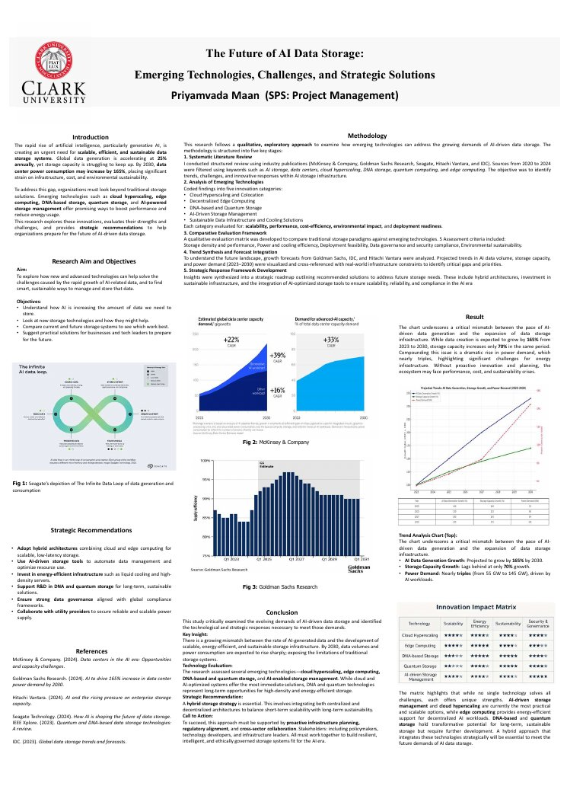

# The Future of AI Data Storage
### Emerging Technologies, Challenges, and Strategic Solutions

**Research presented at the Clark University Graduate Student Council Multi-Disciplinary Conference, April 14, 2025**

[**Poster (PDF)**](docs/future-of-ai-data-storage-poster.pdf) · [**Certificate of presentation**](docs/conference-presentation-certificate.pdf) · [**FARSIGHT, the tool built from this research**](https://github.com/PriyamvadaMaan/farsight)

---

## The problem

Generative AI is creating data faster than the world can store it. Global data generation is growing about 25% a year, storage capacity is not keeping pace, and data center power demand is projected to rise sharply by 2030. Without a plan, organizations face rising cost, performance limits and a growing environmental footprint.

**Research aim:** explore how new and advanced technologies can solve the challenges created by fast-growing AI data, and find practical, sustainable ways to manage and store it.

## Objectives

1. Understand how AI is increasing the amount of data organizations need to store
2. Examine emerging storage technologies and how they might help
3. Compare current and future storage approaches to see which work best
4. Recommend practical steps business and technology leaders can take now

## Methodology

A qualitative, exploratory study in five stages:

| Stage | What I did |
|---|---|
| **1. Systematic literature review** | Reviewed 2020–2024 industry research from McKinsey & Company, Goldman Sachs Research, Seagate, Hitachi Vantara and IDC, filtered by keywords such as AI storage, data centers, cloud hyperscaling, DNA storage, quantum computing and edge computing |
| **2. Analysis of emerging technologies** | Coded the findings into five innovation categories: cloud hyperscaling and colocation, decentralized edge computing, DNA-based and quantum storage, AI-driven storage management, and sustainable infrastructure and cooling |
| **3. Comparative evaluation framework** | Built a qualitative matrix comparing traditional and emerging approaches on five criteria: storage density and performance, power and cooling efficiency, deployment feasibility, data governance and security compliance, and environmental sustainability |
| **4. Trend synthesis** | Cross-referenced 2023–2030 forecasts for AI data volume, storage capacity and power demand against real infrastructure constraints |
| **5. Strategic response framework** | Turned the findings into a roadmap of recommended solutions |

## Key findings

- **A widening gap.** AI-driven data generation is outpacing the growth of storage infrastructure.
- **Power is the hidden constraint.** Data center power demand is projected to nearly triple, from about 55 GW to 145 GW by 2030 (Goldman Sachs Research, 2024).
- **No single technology solves it.** Cloud hyperscaling and AI-driven storage management are the most practical options today. Edge computing adds energy-efficient support for decentralized workloads. DNA and quantum storage promise long-term density and efficiency but need further development.

## Recommendations

1. Adopt **hybrid architectures** that combine cloud and edge for scalable, low-latency storage
2. Use **AI-driven storage tools** to automate data placement and optimize resources
3. Invest in **energy-efficient infrastructure** such as liquid cooling and high-density servers
4. Support **R&D in DNA and quantum storage** for long-term, sustainable capacity
5. Align storage strategy with **data governance** and global compliance frameworks
6. **Partner with utility providers** to secure reliable, scalable power

## The poster

  

## From research to a working tool

The central recommendation, a hybrid strategy tailored to each organization, raised a practical question: *which* mix fits *which* organization? I answered it by building **[FARSIGHT](https://github.com/PriyamvadaMaan/farsight)**, a decision-support prototype that turns this research into tailored, explainable storage recommendations.

## References

- McKinsey & Company (2024). *Data centers in the AI era: Opportunities and capacity challenges.*
- Goldman Sachs Research (2024). *AI to drive 165% increase in data center power demand by 2030.*
- Hitachi Vantara (2024). *AI and the rising pressure on enterprise storage capacity.*
- Seagate Technology (2024). *How AI is shaping the future of data storage.*
- IEEE Xplore (2023). *Quantum and DNA-based data storage technologies: A review.*
- IDC (2023). *Global data storage trends and forecasts.*

---

**Priyamvada Maan** · M.S. Project Management, Clark University
[Portfolio](https://priyamvadamaan.github.io) · [LinkedIn](https://www.linkedin.com/in/priyamvadamaan) · [GitHub](https://github.com/PriyamvadaMaan)
